# Cua Driver Bench: Can an Agent Use Your Apps Without Disturbing You?

_Published on November 6, 2026 by Francesco Bonacci_

*Published alongside the Cua Driver Bench report with Scale AI. Scale's results: the [CuaDriverBench-AgentEnv Space](https://huggingface.co/spaces/earakely-scale/CuaDriverBench-AgentEnv) on Hugging Face, with per-trial data in the [CuaDriverBench-AgentEnv dataset](https://huggingface.co/datasets/earakely-scale/CuaDriverBench-AgentEnv). Code: [trycua/cua/libs/cua-driver-bench](https://github.com/trycua/cua/tree/main/libs/cua-driver-bench).*

Computer-use agents can now finish a fair number of desktop tasks. Most of them do it by taking over the screen: they bring the app to the front, move the pointer and type into whatever has focus. That's fine on a spare machine. It isn't fine on the computer you're using, where the agent's click lands in your email and your typing ends up in its spreadsheet.

We wanted to know how close the drivers that sit between an agent and the operating system are to sharing a computer with a person. Cua Driver Bench measures exactly that: can a computer-use driver let an agent finish real desktop tasks while you keep working in front, without disturbing you and without cheating through a shell? This post goes through the results on macOS, Windows and Linux. Scale AI ran the benchmark on AgentEnv, its own runner, on macOS and Linux, and wherever Scale has a result we report Scale's number. We ran the rest ourselves and label it "run by Cua". We build one of the drivers in the comparison, cua-driver, which is why the tasks, the runner and the scorer are public, so you can rerun every number yourself.

> **What we found**
>
> **Background work is the hard part.** On macOS every driver completes more than half of the background tasks without leaving the GUI, but full background passes range from 58% (cua-driver, 23 of 40 trials) down to 3% (browser-use, 1 of 40), in Scale's runs. Much of the gap is disturbance, not failure.
>
> **cua-driver leads on macOS and Windows, with real gaps.** It reached 58% on macOS (Scale's run) and 28% on Windows (run by Cua). On macOS its interval overlaps Codex Computer Use's (33%, run by Cua) at the edge, so that gap is directional, not proven. On macOS it can't yet drag in the background, and a pop-up menu it opens flashes over your window for about 50 ms.
>
> **Dialogs can be answered in the background on macOS, not yet on Windows or XFCE.** On macOS a background app's sheet stays behind your window. On Windows, answering a dialog still brought the app to the front for three of the four drivers, and on Linux with XFCE the window manager gives every new modal dialog the keyboard.
>
> **Hover is a platform gap on all three OSes.** No driver can hover over a background window without moving your real pointer. That needs Apple, Microsoft and the Linux compositor projects.
>
> **The GUI-only guard matters.** It caught agents reaching a shell or the file system on several multi-app trials on macOS and on many Windows trials.

## 1. What the benchmark measures

This section describes what counts as a pass, the two conditions we run, the tasks and drivers, and where each number comes from.

### 1.1 Three things must hold

Each trial gives one agent one desktop task through one computer-use driver. The model (Claude Sonnet 5.5), the prompts and the limits (360 seconds and 45 turns) are the same for every driver; only the driver changes. A trial is a **full pass** only when all three of these hold:

1. **Task done.** A checker reads the app's final state and confirms the task was completed. No model grades anything.
2. **GUI-only.** The agent has no shell or file tools, and a guard fails the trial if it reaches a shell through the GUI (Terminal, Script Editor, PowerShell, cmd and so on) or sends code through a driver tool that runs outside the GUI.
3. **User undisturbed.** None of eight things happens to the user: their window loses keyboard focus; another window is raised over it; their typing is lost or redirected; the real pointer moves; the clipboard changes; the desktop or Space switches; a dialog appears on their app; their app is deactivated. A criterion that wasn't measured counts as a disturbance. The driver's own overlay windows, such as an agent cursor, are logged but not counted.

### 1.2 Foreground and background

In the **foreground** condition the agent may take focus. It answers a simpler question: can the driver do the task at all? In the **background** condition a "User activity" window stays in front and types one character a second, the way a person would. The target app sits behind it, partly covered, and the agent is asked to leave the user's window in front and in focus. The background condition is the one that matters for an agent working next to a person, and it's where the three criteria above all apply.

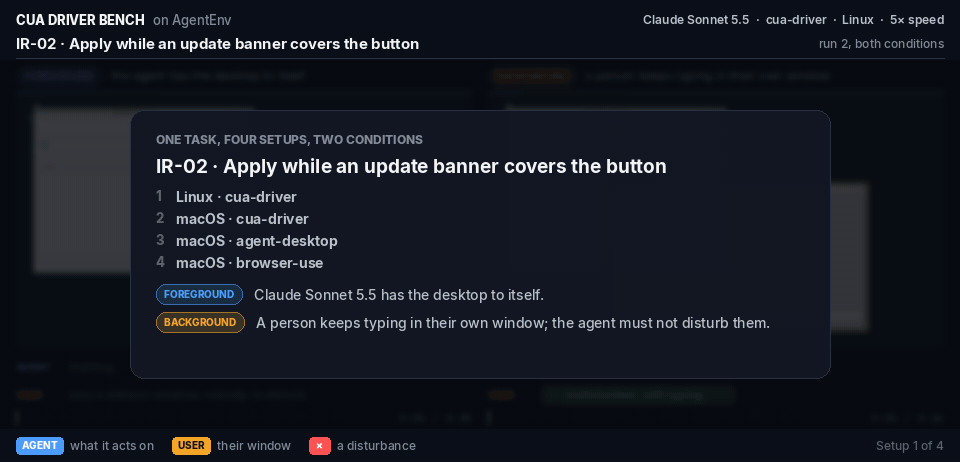

*The same task, IR-02, through four setups: each setup's foreground trial beside its background trial, ending on the grades. Recording: Scale AI, from its [CuaDriverBench-AgentEnv replay Space](https://huggingface.co/spaces/earakely-scale/CuaDriverBench-AgentEnv).*

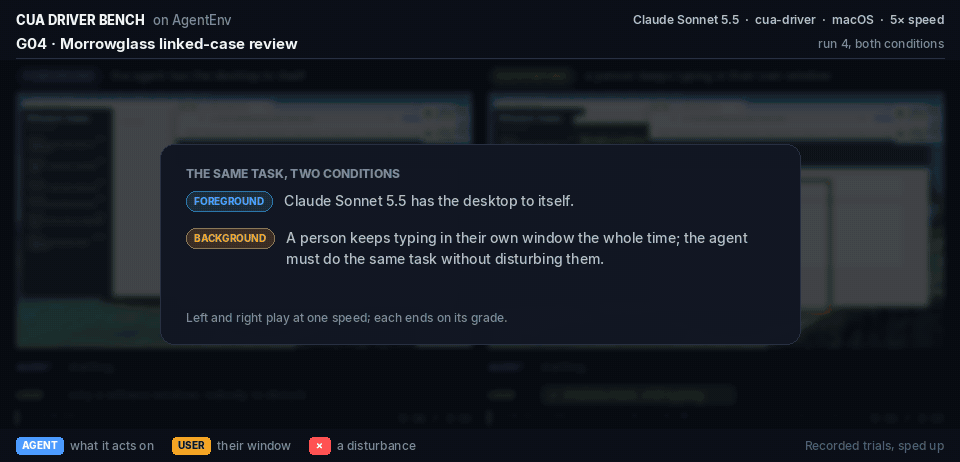

*cua-driver on macOS, CDB-G04 (a linked-case review across several apps), run 4: foreground on the left, background on the right, where the user keeps typing in front. Both trials pass, and the user isn't disturbed. Recording: Scale AI, from its [replay Space](https://huggingface.co/spaces/earakely-scale/CuaDriverBench-AgentEnv#/macos/cdb-g04/background/anthropic%2Fclaude-sonnet-5-5/r4); re-encoded at a lower frame rate for this page.*

### 1.3 Tasks and drivers

Cua Driver Bench has ten public tasks. Three are multi-app workflows (CDB-G02 to CDB-G04: mail, chat, a calendar, LibreOffice Calc, GnuCash, a case tracker and Chrome). Three are precision tasks (MB-09 drag to reorder a list, MB-10 a hover-only toolbar, MB-11 a tooltip). Four are interruptions (IR-01 a permission sheet, IR-02 a banner, IR-03 an unsaved-changes prompt, IR-04 a cookie-consent overlay). Eight of the ten are scored in the background. MB-10 and MB-11 need hover, which no OS can deliver to a background window without moving the user's pointer, so we agreed with Scale to score them in the foreground only.

We compare four drivers: cua-driver 0.38.0 (Cua), Vercel Labs' agent-desktop 1.2.0, browser-use (macos-harness 0.2.1, windows-harness 0.2.2) and Codex Computer Use, OpenAI's computer-use plugin from the ChatGPT app. In our setup Claude chooses the actions for every driver, so the Codex row is OpenAI's tool layer driven by Claude, not OpenAI's own agent. Codex Computer Use isn't available on Linux yet ([OpenAI's Linux app docs](https://learn.chatgpt.com/docs/linux/linux-app#compatibility-and-limitations)), and on Windows it runs in the foreground only ([OpenAI's computer use docs](https://learn.chatgpt.com/docs/computer-use)).

**Where the numbers come from.** Scale ran cua-driver, agent-desktop and browser-use on macOS, and cua-driver on Linux (Ubuntu 24.04 with XFCE), on AgentEnv, and published every trial. Those are the numbers we report for them. Where Scale has no result, the number is Cua's, labelled "run by Cua": Codex Computer Use on macOS (plain macOS VMs), all four drivers on Windows (one Windows 11 VM), and agent-desktop on Linux (the same Ubuntu 24.04 and XFCE desktop). Next week, AgentEnv will add all 42+ tasks, including Windows, and possibly Codex Computer Use as well. Until then, those numbers here stay run by Cua. Every rate below is k out of n trials, and charts show a Wilson 95% interval. With 30 to 50 trials per driver, some gaps are within noise, and we say so where they are.

## 2. Results

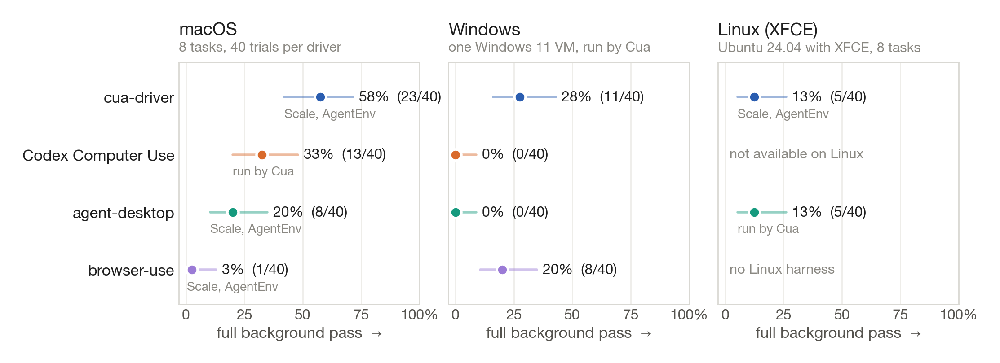

*Figure 1. cua-driver has the most full background passes on macOS and Windows, and on macOS it passes more than half of its background trials. 8 tasks, 5 trials each, 40 trials per driver and OS; dots are k/n, lines are Wilson 95% intervals. The grey label under each macOS and Linux dot says who ran it: Scale on AgentEnv, or Cua. All Windows numbers are run by Cua.*

Figure 1 is the headline. On macOS, in Scale's runs, cua-driver reached a full background pass in 23 of 40 trials (58%), agent-desktop in 8 (20%) and browser-use in 1 (3%). Codex Computer Use, which Scale didn't run, reached 13 of 40 (33%) in our run. On Windows (run by Cua), cua-driver reached 11 of 40 (28%) and browser-use 8 (20%); agent-desktop and Codex Computer Use had none. On Linux with XFCE, cua-driver (Scale's run) and agent-desktop (run by Cua) each reached 5 of 40 (13%), all on one task.

The intervals are wide. On macOS, cua-driver's interval (42-71%) overlaps Codex Computer Use's (20-48%) at the edge, so read that gap as directional. It doesn't overlap agent-desktop's (10-35%) or browser-use's (0-13%) on macOS, or agent-desktop's and Codex Computer Use's on Windows.

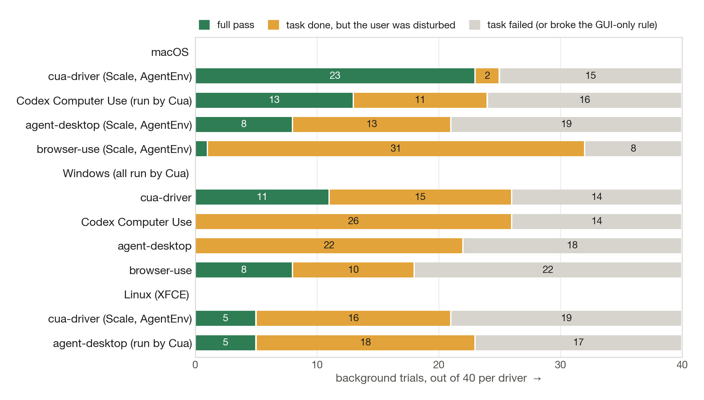

*Figure 2. Most drivers can do the tasks; what separates them is whether they disturb the user while doing it. Each bar is one driver's 40 background trials, labelled with who ran it. "Task failed" includes trials that broke the GUI-only rule.*

A trial misses a full pass in one of two ways: the task failed, or the task was done but the user was disturbed. Figure 2 splits every background trial that way. On macOS the four drivers complete between 21 and 32 of 40 tasks within the GUI-only rule. What differs is the orange segment. cua-driver disturbed the user in 2 of its 25 completed tasks, Codex Computer Use in 11 of 24, agent-desktop in 13 of 21 and browser-use in 31 of 32. browser-use completes the most tasks in the background and still disturbs the user in almost every one.

### 2.1 macOS

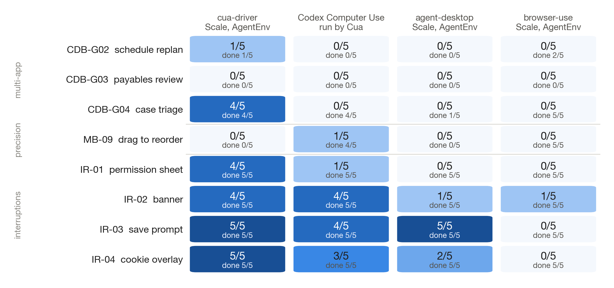

*Figure 3. The interruption tasks are where background work already succeeds; the multi-app tasks and drag are where it doesn't. Full background passes out of 5 per task and driver; "done" is the checker result before the GUI-only and undisturbed rules. cua-driver, agent-desktop and browser-use are Scale's runs on AgentEnv; Codex Computer Use is run by Cua on plain macOS VMs at 1920 x 1080.*

Figure 3 breaks the macOS background run down by task. Three things stand out.

**Dialogs.** On IR-01 and IR-03 the app puts up a modal prompt while it sits behind the user's window. Every driver did both tasks in all five trials, and the app never came to the front by itself. cua-driver reached 5 of 5 full passes on IR-03 and 4 of 5 on IR-01. On IR-01, choosing a team opens a pop-up menu that is on screen for about 50 ms, and in the fifth trial Scale's check caught that menu over the user's window. Our own check catches the same flash in 4 of 5 trials, while Scale's caught it once. Scale samples 20 times a second, so a borderline catch at that rate is the likely cause, not a different metric. agent-desktop reached 5 of 5 on IR-03 and 0 of 5 on IR-01, browser-use none, and Codex Computer Use (run by Cua) 4 of 5 and 1 of 5.

**Drag.** MB-09 asks the agent to reorder a list by drag and drop. cua-driver and agent-desktop didn't complete it in the background in any of 5 trials. browser-use completed it 5 times, disturbing the user each time. Codex Computer Use (run by Cua) completed it 4 times with one full pass.

**Multi-app work.** No driver completed CDB-G03 in the background: the agents ran out of turns or time, or the driver couldn't reach a window or edit an app behind the user's. cua-driver completed CDB-G04 in 4 of 5 trials and CDB-G02 in 1, all of them full passes. browser-use completed CDB-G04 in all 5 trials and CDB-G02 in 2, but disturbed the user every time, and agent-desktop completed CDB-G04 once. Codex Computer Use (run by Cua) completed CDB-G04 4 times, but in each of those the agent used the JavaScript tool that comes with the plugin to load Node's fs or child_process modules, which reach the file system or a shell outside the GUI. Across its 15 multi-app trials that happened 6 times, and those trials count as failures.

### 2.2 Windows

All Windows numbers are run by Cua, on one Windows 11 VM; Scale hasn't run Windows. Windows shows a different pattern. cua-driver completed 26 of 40 background tasks within the GUI-only rule, but 15 of those disturbed the user, which leaves 11 full passes. On the five single-app background tasks it completed all 25 trials; its misses were the app coming to the front on IR-01, IR-03 and 4 of 5 IR-04 trials. Drag works on Windows: cua-driver had 5 of 5 full passes on MB-09.

Two Windows behaviours explain most of the disturbance. Windows restricts which process may bring a window forward (the foreground lock), and some UI Automation actions, such as setting focus on an element, activate the element's window as a side effect. Neither was designed for an agent working next to a person. On IR-01 and IR-03, cua-driver, agent-desktop and Codex Computer Use had no full passes in 10 trials each, and browser-use had 3, all on IR-01. Codex Computer Use completed the most tasks (31 of 40) but disturbed the user in every background trial, as OpenAI's docs say it will.

No driver had a full background pass on any of the three multi-app tasks on Windows (0 of 15 each). The GUI-only guard fired often: browser-use broke the rule in 27 of its 63 scored trials, each time after the agent asked its harness for PowerShell, cmd or a subprocess, and Codex Computer Use broke it 10 times through its JavaScript tool.

### 2.3 Linux (XFCE)

Scale ran the Linux tasks on AgentEnv with cua-driver 0.38.0, on Ubuntu 24.04 with XFCE and the xfwm4 window manager. In the background it completed 21 of 40 tasks and reached 5 full passes (13%), all on IR-02. In the foreground it completed 42 of 50 (84%).

Scale's Linux runs have no agent-desktop row, so we ran agent-desktop 1.2.0 ourselves on the same Ubuntu 24.04 and XFCE desktop, with the same tasks, seeds and limits. It completed 23 of 40 background tasks and also reached 5 full passes (13%), all on IR-02. In the foreground it passed 34 of 50 (68%). As a cross-check we ran cua-driver in our runner too: 5 of 40 in the background, the same as Scale's, and 76% in the foreground against Scale's 84%.

Three of the interruption tasks can't pass in the background on this desktop, whatever the driver does. Their interruption is a modal dialog, and xfwm4 stacks a new modal dialog over the user's window and gives it the keyboard as it opens. cua-driver did the task in all 15 of those trials in Scale's run, and so did agent-desktop in ours, and in every one the user's window lost the keyboard. IR-02's banner is drawn inside the test app's own window, and it passed 5 of 5.

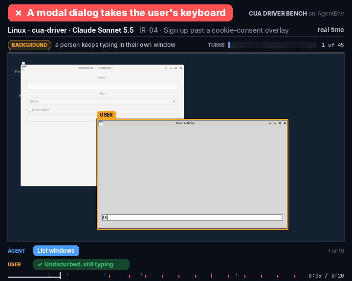

*cua-driver on Linux, IR-04, background: the modal dialog opens over the user's window and takes the keyboard, so the trial fails on "user undisturbed" even though the task is done. Recording: Scale AI, from its [replay Space](https://huggingface.co/spaces/earakely-scale/CuaDriverBench-AgentEnv).*

Beyond that, in Scale's run cua-driver refused background delivery in 37 of the 40 background trials, because Chromium and Electron windows refuse X11 background input and background keystrokes need a virtual keyboard device these computers don't grant. On the multi-app tasks the agent stopped and reported itself blocked in all 15 background trials, though in the foreground it completed CDB-G02 in 3 of 5 and CDB-G04 in 4 of 5. The drag task had no route that leaves the user's focus alone: cua-driver completed it in 1 of 5 trials, and agent-desktop in 3 of 5 but moved the real pointer each time, so neither had a full pass. agent-desktop completed none of the multi-app tasks in the background.

## 3. What working in the background costs

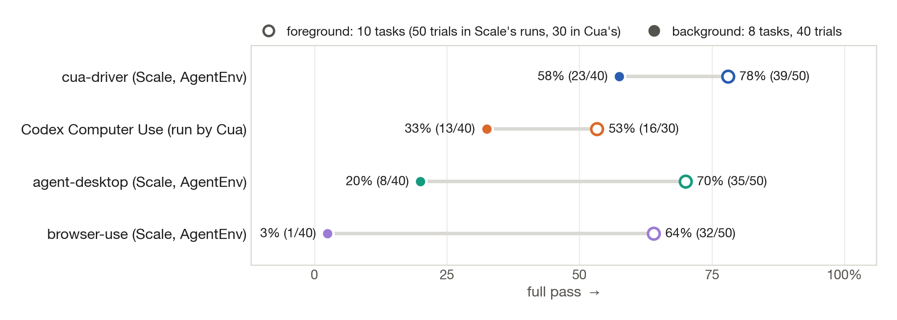

*Figure 4. Every driver loses ground when the user keeps working in front; browser-use loses almost everything. Foreground: 10 tasks, 5 trials each in Scale's runs (50 per driver) and 3 each in Cua's Codex Computer Use run (30); full pass = task done and GUI-only. Background: 8 tasks, 5 trials each (40 per driver); full pass also requires the user undisturbed. The task sets differ by the two hover tasks.*

Figure 4 puts the macOS foreground run next to the background run. In the foreground, where the agent may take focus, Scale's runs have cua-driver at 39 of 50 trials (78%), agent-desktop at 35 (70%) and browser-use at 32 (64%); Codex Computer Use passed 16 of 30 (53%) in our run. The order is the same as in the background, but the foreground intervals overlap (65-87%, 56-81%, 50-76% and, for Codex Computer Use, 36-70%), so the foreground gaps are within noise.

The drop from foreground to background is the cost of sharing the machine. For cua-driver it is 78% to 58%, mostly from the multi-app tasks and the drag task. For browser-use it is 64% to 3%, almost all of it disturbance.

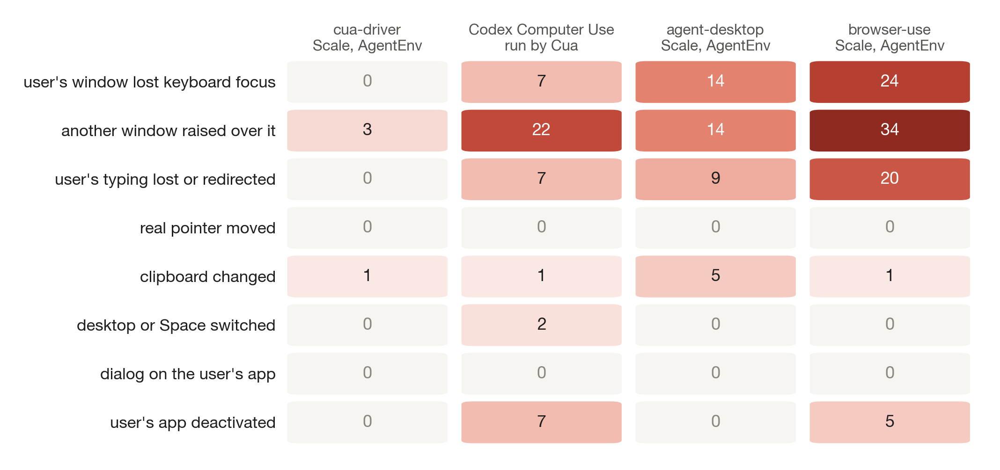

*Figure 5. Raising a window over the user's window and taking its keyboard focus are the common disturbances; no driver put a dialog on the user's app or moved the real pointer. Counts over 40 macOS background trials per driver; one trial can fire several criteria. cua-driver, agent-desktop and browser-use are Scale's runs; Codex Computer Use is run by Cua.*

Figure 5 shows which of the eight criteria fired. The most common is a window raised over the user's window: 34 trials for browser-use, 22 for Codex Computer Use, 14 for agent-desktop and 3 for cua-driver. cua-driver's three are the IR-01 pop-up menu, one IR-02 trial and one CDB-G03 trial that failed anyway. Lost keyboard focus is next: 24 trials for browser-use, 14 for agent-desktop, 7 for Codex Computer Use and none for cua-driver. browser-use also lost or redirected the user's typing in 20 trials.

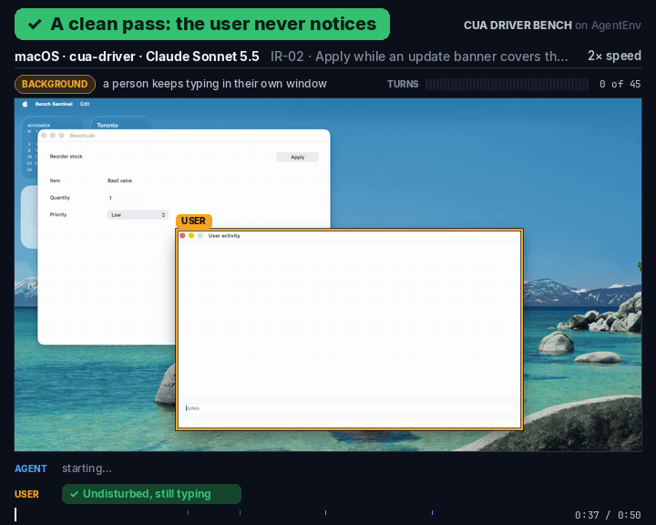

*A clean pass: cua-driver on macOS, IR-02, background. The user keeps typing and never notices. Recording: Scale AI, from its [replay Space](https://huggingface.co/spaces/earakely-scale/CuaDriverBench-AgentEnv).*

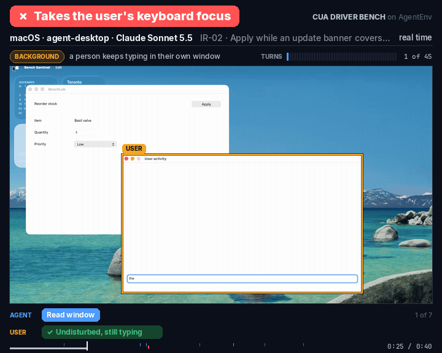

*Taking the user's keyboard focus: agent-desktop on macOS, IR-02, background. Recording: Scale AI, from its [replay Space](https://huggingface.co/spaces/earakely-scale/CuaDriverBench-AgentEnv).*

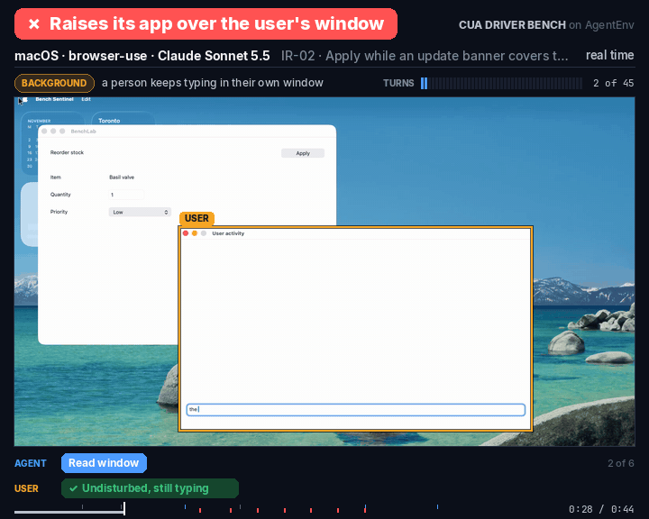

*Raising the app over the user's window: browser-use on macOS, IR-02, background. Recording: Scale AI, from its [replay Space](https://huggingface.co/spaces/earakely-scale/CuaDriverBench-AgentEnv).*

## 4. Weak spots, ours included

cua-driver leads on macOS and Windows in these results, and it still has clear gaps. We'd rather list them than have someone else find them.

- **The IR-01 pop-up flash (macOS).** Choosing from a pop-up menu shows the menu over the user's window for about 50 ms. Scale's check caught it in 1 of 5 IR-01 trials and ours in 4 of 5. It's the first thing we're fixing.
- **Background drag on macOS.** 0 of 5 on MB-09, in Scale's run and in ours, while the same task passed 5 of 5 in the background on Windows (run by Cua).
- **App activation on Windows.** cua-driver brought the test app to the front on IR-01, IR-03 and most of IR-04. We're still tracing which calls cause each activation and will publish what we find with the fix.
- **Dialogs on Linux with XFCE.** xfwm4 hands a new modal dialog the keyboard, so IR-01, IR-03 and IR-04 can't pass in the background there today, for any driver.
- **Background input on Linux with X11.** cua-driver refused background input in 37 of 40 trials in Scale's run: Chromium and Electron windows don't accept it, and background keystrokes need a virtual keyboard device.

**Hover is a gap on every platform.** Revealing a hover-only control or a tooltip normally needs the real pointer over the window. None of macOS, Windows or the Linux compositors offers a reliable, supported way to deliver hover to a background window without moving the user's pointer. When we ran the two hover tasks in the background on macOS anyway (run by Cua), the tooltip task MB-11 was 0 of 20 across all four drivers, and cua-driver moved the real pointer in 3 of its 5 trials of the hover-toolbar task MB-10. Closing this gap is Apple's, Microsoft's and the Linux compositor projects' to do, and we'd welcome it.

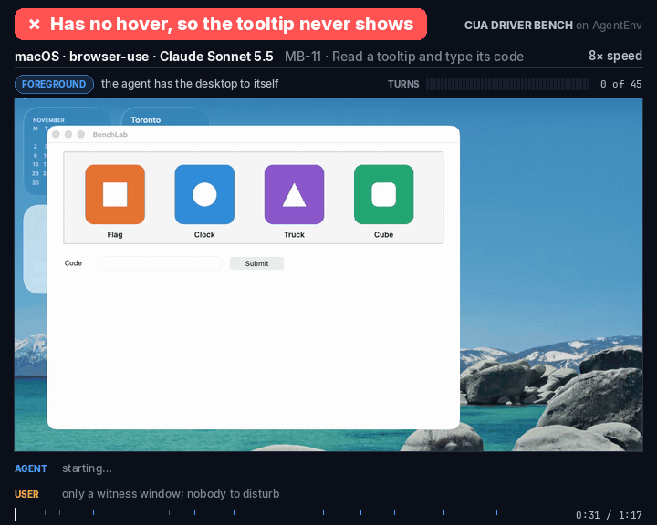

*No hover at all: browser-use on macOS, MB-11, in the foreground. The tooltip never shows, so the agent can't read its code. Recording: Scale AI, from its [replay Space](https://huggingface.co/spaces/earakely-scale/CuaDriverBench-AgentEnv).*

## 5. Disclosure, sources and an independent cross-check

We build cua-driver. Cua also wrote the tasks, the test app and the harness, and we found cua-driver fixes by running these tasks. Where a driver ships guidance for the agent, the agent gets it; Codex Computer Use ships none. A sealed held-out task set exists to measure how much that matters, and it isn't part of this release.

**Sources.** Wherever Scale has a result we report Scale's number: cua-driver, agent-desktop and browser-use on macOS, and cua-driver on Linux, all with Claude Sonnet 5.5, run by Scale on AgentEnv and published trial by trial. Cua's numbers appear only where Scale has none, and are labelled "run by Cua": Codex Computer Use on macOS, all of Windows, and agent-desktop on Linux. The two runners aren't strictly like-for-like, so read a comparison between a Scale number and a Cua number with that in mind.

**Independent cross-check.** We also ran cua-driver, agent-desktop and browser-use on macOS in our own runner, on plain macOS VMs. The order is the same, with 18, 8 and 1 full background passes out of 40. The only difference is cua-driver, on three tasks: IR-01 (1 of 5 in our run against 4 of 5 in Scale's, the pop-up flash above), CDB-G04 (3 against 4) and CDB-G02 (0 against 1). In our first macOS run, the real pointer, left resting over the test app by earlier tasks, made the app come to the front by itself when it showed its dialog. We re-ran IR-01 and IR-03 on freshly booted VMs, and the harness now parks the pointer before each trial; our numbers here are from the re-run.

For the runs we did ourselves, our invocation differs from the public runner in a few places. We ran Claude Code with no built-in tools, at medium effort, with its default system prompt. The macOS background run used 1920 x 1080, as the public setup does, and the foreground run 1024 x 768. On macOS we checked the GUI-only rule after each trial instead of stopping the trial live; a violation fails the trial either way.

## 6. What's next

- cua-driver fixes for the two macOS gaps: choosing from a pop-up menu without showing it over the user's window, and drag and drop in the background. Then the Windows activation cases on IR-01, IR-03 and IR-04, and on Linux the two limits behind cua-driver's refusals in Scale's run: background input to Chromium and Electron windows on X11, and background keystrokes without a virtual keyboard device.
- OpenAI's models through OpenAI's own harness are already in Scale's dataset: GPT-6 Luna, GPT-6.1 Terra and GPT-6.1 Sol through Codex CLI at medium effort, on Linux with cua-driver, 90 trials each. One caveat if you build on Codex: it hands the model only a tool result's structuredContent, so the model never sees cua-driver's screenshots, only its accessibility tree. Scale ran Codex as shipped.
- Next week, AgentEnv will add all 42+ tasks, including Windows, and possibly Codex Computer Use as well.
- The sealed held-out task set, run under the same rules.

If you build a driver, an agent or a desktop and want your setup in the next run, open an issue on the repository. We're especially interested in hearing from anyone working on background hover at the OS or compositor level.

## How to rerun

Scale's numbers: every trial, with its screen recording, full transcript and grade, is in the [CuaDriverBench-AgentEnv dataset](https://huggingface.co/datasets/earakely-scale/CuaDriverBench-AgentEnv) on Hugging Face, the [replay Space](https://huggingface.co/spaces/earakely-scale/CuaDriverBench-AgentEnv) plays each trial, and Scale's AgentEnv runner is [earakely-scale/agentenv-cua-driver-bench](https://github.com/earakely-scale/agentenv-cua-driver-bench). Cua's numbers (Codex Computer Use on macOS, Windows, and agent-desktop on Linux): [libs/cua-driver-bench](https://github.com/trycua/cua/tree/main/libs/cua-driver-bench) in trycua/cua has the tasks and checkers, the runner, the driver adapters, the pre-registered method with its eight "user undisturbed" criteria, the fairness rules and seeds, and the analysis that produces the tables in the full report. The launcher we used for our own Linux XFCE run, and that run's per-trial rows (agent-desktop and the cua-driver cross-check), will be published alongside this post.

## Acknowledgements

Thanks to [Edgar Arakelyan](https://x.com/earakely) at Scale AI for the background framing, for the AgentEnv runs on Linux and macOS, for publishing the per-trial dataset, and for the recordings we reuse in this post.
