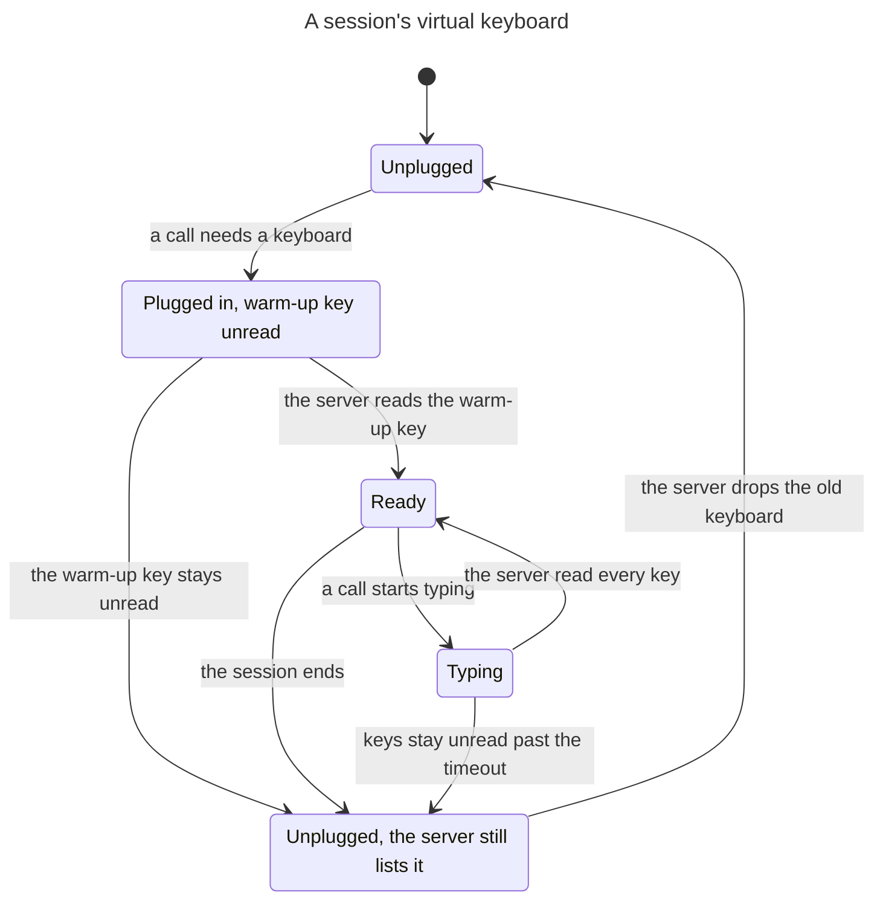

# The virtual keyboard's lifecycle

One session's uinput keyboard on the X11 virtual master keyboard route
(`path=mpx_uinput`). `Keyboard`, `Delivery` and `plugged_keyboard` in
`src/input/mpx_keyboard.rs` own it. `virtual_keyboard.tla` is the model, and
this chart is drawn from it.

The chart leaves out the steps that stay in one state: the call writes a
key, the server reads a key, and the server's input thread stalls or resumes.

## Where each state lives

| State | In the code |
|---|---|
| Unplugged | The session has no entry in `uinput_keyboards`. |
| Unplugged, the server still lists it | No entry either. `plugged_keyboard` waits until the server stops listing the old name before it creates a device. |
| Plugged in, warm-up key unread | A `Keyboard` that only `plugged_keyboard` holds, with a `Delivery` writing the warm-up key. |
| Ready | The session's entry in `uinput_keyboards`. |
| Typing | A `Delivery` in `deliver`. The caller holds the MPX operation lock. |

## Rules

TLC checks these on `virtual_keyboard.cfg`, and all hold.

| Rule | Meaning |
|---|---|
| `ReadyIsClean` | A keyboard that stays plugged in between calls has nothing unread and no key down. |
| `NoRepeat` | The server never types a key the driver did not write. |
| `NoKeyAfterRestore` | A call's key is never read after that call's borrowed keycodes were restored. |
| `CountsOnlyItsOwnKeys` | A call confirms only its own keys. |

`virtual_keyboard_before.cfg` turns off the three rules of the code that
keep them: unplug when keys stay unread, fail the plug-in when the warm-up
key stays unread, and turn off the server's key repeat. All four then break.
`tests/virtual_keyboard_xorg.rs` replays one path for each of the three on
a real Xorg.
